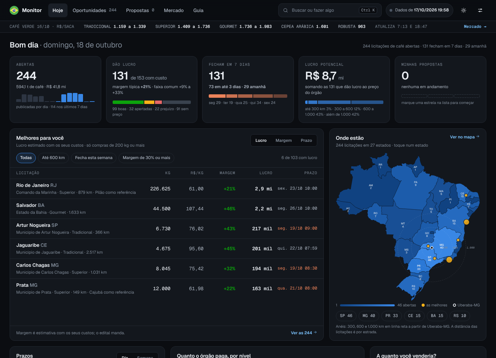
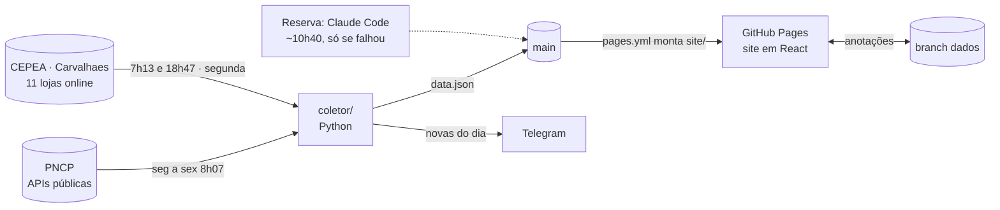

<div align="center">

# ☕ Monitor de Licitações

**Licitações de café abertas no Brasil, com preço, custo, margem e prazo, num painel só.**

[](https://xmiratorta.github.io/monitor-licitacoes/)
[](https://github.com/xMiraTorta/monitor-licitacoes/actions/workflows/atualizar.yml)
[](https://github.com/xMiraTorta/monitor-licitacoes/actions/workflows/pages.yml)
[](https://github.com/xMiraTorta/monitor-licitacoes/actions/workflows/testes.yml)

<a href="https://xmiratorta.github.io/monitor-licitacoes/"></a>

</div>

## O que ele faz

- Lê todas as compras com propostas abertas no **PNCP** (Portal Nacional de Contratações Públicas), separa as de **café torrado e moído ou em grão**, lê o edital de cada uma e calcula volume em kg, R$/kg, nível de exigência, distância por estrada desde Uberaba-MG e a **margem estimada** com os custos do produtor (grão, torra, embalagem, frete, impostos).
- Mostra tudo num site que abre na tela **Hoje**: melhores oportunidades, mapa, prazos, quanto cada nível paga, simulador de preço, exigências e marcas citadas. Depois: lista com filtros e detalhe de cada licitação (“Vale a pena?”), quadro de **propostas**, **mercado** do café verde e guia passo a passo da proposta.
- Atualiza sozinho nos dias úteis de manhã e avisa as licitações novas no **Telegram**. O preço do café verde (CEPEA e Carvalhaes) atualiza duas vezes por dia útil; o varejo das marcas, uma vez por semana.
- Favoritos, status, preços, notas, checklist, pisos e custos são gravados pelo próprio site na branch `dados` deste repositório e sincronizam entre celular e computador.

## Como funciona



Travas de segurança: se a coleta vier incompleta (erro na listagem, muitas falhas, queda brusca no número de compras), nada é publicado e o site mantém os dados anteriores.

## Estrutura

| Caminho | Conteúdo |
|---|---|
| `site/` | O site (React + Vite + TypeScript). `npm run build` gera `site/dist/`, publicado pelo `pages.yml` junto com o `data.json` |
| `data.json` | Dados publicados (formato em `coletor/modelos.py`) |
| `coletor/` | Coleta no PNCP, leitura do edital, classificação do café, custo e margem, mercado, varejo, Telegram |
| `coletor/distancias_uberaba.csv` | Km e tempo de viagem por estrada desde Uberaba (OpenStreetMap, calculado uma vez) |
| `coletor/cache/sem_cafe.json` | Compras já verificadas sem café (não são baixadas de novo) |
| `docs/pesquisas/` | Pesquisas que embasam as premissas de custo (grão por nível, frete, impostos) |
| `tests/` | Testes automáticos (sem internet), inclusive do site montado no navegador |
| `.github/workflows/` | Coleta diária, preços de mercado, publicação do site, testes e avisos |

## Para desenvolver

```bash
# coletor (Python 3.13)
python -m venv .venv && .venv/bin/pip install -r requirements.txt
.venv/bin/playwright install chromium                  # navegador para os testes do site
.venv/bin/python -m pytest -q                          # todos os testes (monta o site se precisar)
.venv/bin/python -m coletor coletar --novas novas.json # coleta real (15 a 60 min)

# site (Node 22)
cd site && npm install
npm run dev                                            # http://localhost:5173 (copie data.json para site/public/ ou use o dist)
npm test && npm run build                              # testes unitários e versão final em site/dist
```

Instruções para agentes de IA: `CLAUDE.md`. Estado atual do trabalho: `HANDOFF.md`.

## Fontes e limites

- Dados: PNCP (pncp.gov.br), públicos. Classificação do café, peso das embalagens, nível de exigência e plataformas são **inferidos** do texto dos itens e do edital e podem ter erros; confira sempre o edital.
- Custo e margem: estimativas para triagem, com premissas documentadas em `docs/pesquisas/` e ajustáveis no site (Ajustes). Café verde: CEPEA/ESALQ (CC BY-NC 4.0) e Escritório Carvalhaes, com a receita de blend das Resoluções SAA-SP 28, 30 e 31/2007.
- Distâncias: OSRM sobre OpenStreetMap, estimativa por estrada. Municípios: base IBGE de [kelvins/municipios-brasileiros](https://github.com/kelvins/municipios-brasileiros) (MIT). Mapa: malha do IBGE.
